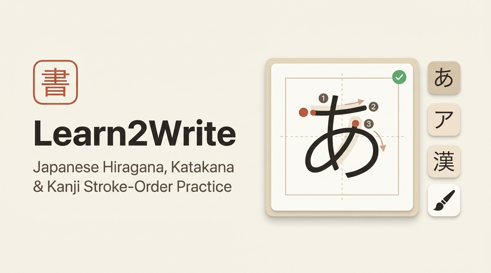

# Learn2Write



A completely offline, zero-backend React single-page application (SPA) for learning Japanese (**Hiragana**, **Katakana**, and daily-use **Kanji**) stroke order on touch screens and desktop browsers, ready to host on GitHub Pages.

**Live App:** https://aayushkumaraks.github.io/Learn2Write/

## Features

- **100% Offline Single-Page App & Auto-Updating Cache:** All stroke datasets, styles, icons, and system font stacks are bundled locally with zero external runtime network requests. A build-generated Service Worker (`sw.js`) and Web App Manifest (`manifest.webmanifest`) precache the app shell for offline use, use network-first navigation when online, clear old versioned caches automatically, and reload on Service Worker upgrades.
- **Japanese Stroke Datasets:** Complete charts for **Hiragana** (46), **Katakana** (46), and daily-use **Kanji** (45) powered by KanjiVG stroke-order paths. *(Thai and Hindi are currently disabled in the language selector.)*
- **Four Difficulty Levels & Auto-Smoothing:** Switch between **Easy**, **Medium**, **Strict**, and **Parents Oversight** from the login screen, toolbar stepper, or Profile page (with the active difficulty badge shown on the active **Practice** / **Profile** tab pill). **Easy** and **Medium** automatically smooth hand-drawn strokes, while **Strict** and **Parents Oversight** evaluate raw curves. Progress and unlocked stages are tracked separately per difficulty.
- **Gamified Stage Progression & Feedback:** Characters ahead stay locked until earlier ones are completed, with a pop-up prompt when clicking a locked character. Mismatches show a **Retry** pop-up until your first match on a character; succeeding plays a continuous confetti celebration and offers a one-time **Keep Practicing** / **Move Forward** modal before entering practice mode (animation + checkmark/cross icon only).
- **Offline User-Name Profiles & Browser User List:** Log in or switch between local browser users using only a **User name** (no password). Progress is persisted locally in both `localStorage` and `IndexedDB` (with `navigator.storage.persist()` and cross-tab sync).
- **Profile Dashboard & Management:** View per-difficulty completion, stroke-validation accuracy, Japanese script breakdowns, and a user-wise comparison table across all local browser users, plus **Reset Progress** and **Delete Profile** actions with confirmation dialogs.
- **Collapsible Writing Tools Dock & Quick Canvas Actions:** A 2×2 **Brush & Ink** side dock (**2B Pencil**, **Calligraphy Brush**, **Ballpoint Pen**, **Felt Marker**, tip sizes, and ink colors) that starts collapsed on small viewports, alongside top-left floating icon-only **Undo** and **Clear** buttons on the canvas.
- **Stroke-Order Guide Animation & Practice Grids:** Animated stroke-by-stroke playback with moving directional indicator, numbered stroke order, speed toggle (`Normal` / `Slow`), replay (`Space`), per-stroke step buttons, and switchable crosshair (`十字リーダー`), 4×4 quad, or blank grids.
- **Automatic Touch Screen Detection:** Detects touch capability (`ontouchstart`, `navigator.maxTouchPoints`, `(pointer: coarse)`) and binds native `touch*` listeners on touch devices or `mouse*` listeners on desktop, with a manual toggle for hybrid devices.

## Local Development

```bash
npm install
npm run dev
```

## Testing & Build

```bash
npm test
npm run build
```

## Deploying to GitHub Pages

1. Push this repository to GitHub with `main` as the default branch.
2. In your GitHub repository, open **Settings → Pages** and set **Source** to **GitHub Actions**.
3. The included workflow (`.github/workflows/deploy.yml`) automatically runs tests, builds `./dist` with relative asset paths (`base: './'`) and an offline Service Worker (`./sw.js`), and deploys to GitHub Pages.

## Attribution

Japanese stroke order vector data is sourced from [KanjiVG](https://kanjivg.tagaini.net/) under the Creative Commons Attribution-Share Alike 3.0 license.
